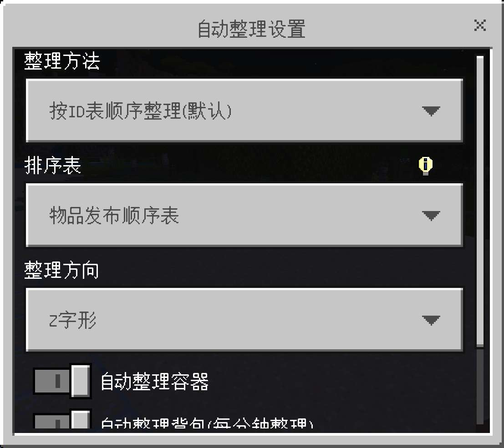

## SorterBE 自动整理

  

### 简介

基岩版自动整理行为包，启用功能后打开容器即可自动整理。

行为包特点:

- 2 种整理方法, 2 种整理方向, 2 张排序表
- 自动合并同类堆叠为满堆
- 支持手动键入命令整理
- 支持药水整理与实体整理
- bds 服务器兼容

### 下载

[下载最新版](https://github.com/XiaoYangx666/SorterBE/releases/latest)
[查看全部版本](https://github.com/XiaoYangx666/SorterBE/releases)
[Gitee 镜像](https://gitee.com/ykxyx666_admin/sorter-be)

### 使用方法：

1. 在地图或服务器中加上行为包。
2. 进入游戏，聊天发送"/sorter"，即可在弹出 UI 中开启自动整理。
3. 对着容器，发送/r，可以手动整理；对着空气，发送/r 可以整理背包。
4. 对着末影箱，发送/r，或打开末影箱（开启自动整理时），可以整理自己的末影箱。

### 温馨提示:

漏斗不会被自动整理，只能输入/r 手动整理，不用担心你的分类机被搞坏了。

### 反馈与支持:

1. 如有 bug，请联系我反馈。游戏版本不对无法使用，不是 bug。
2. 如果你有附魔书的整理思路，我们可以再优化优化

### 开发相关

构建、测试、物品表更新与发布流程见 [docs/development.md](docs/development.md)。
